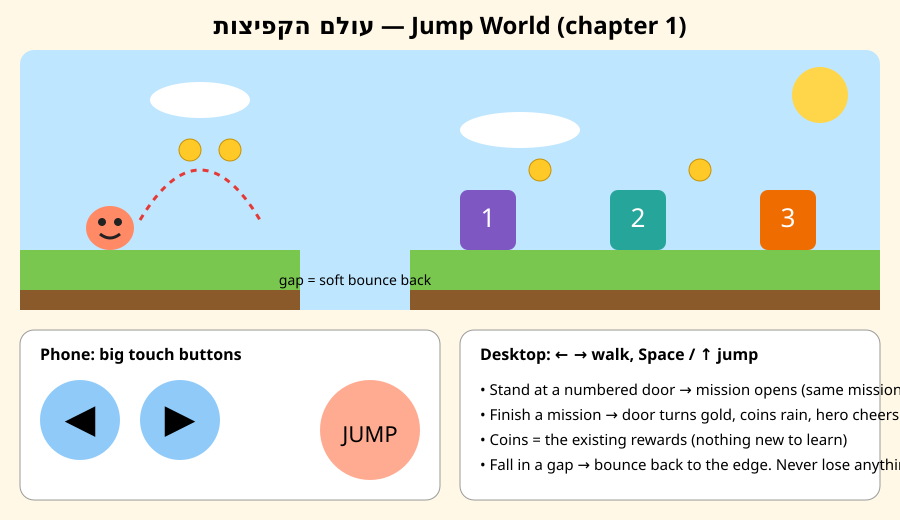

# #669 Jump World: one-page design (for owner approval, before any build)

**Idea:** a calm side-scrolling meadow. Oren walks and jumps; 3 numbered doors are the 3 missions. Original hero (a round friendly blob), original scenery, original sounds. No brands.

**How it links to missions and rewards**
- Walk to door 1, 2, 3 → the existing mission opens (same content, same voice).
- Finishing a mission → its door turns gold and the existing reward coins appear. No new currency.
- All 3 gold → the existing "day done" screen.

**Calm, never frustrating:** no enemies, no timer, no lives. A fall into a gap gently bounces back to the edge. Progress is saved per door; nothing is ever lost.

**Controls:** desktop ← → and Space/↑; phone: 2 big walk buttons + 1 big jump button.

**Chapter 1 scope after approval:** one meadow, 3 missions (reusing existing ones), Hebrew kid text with nikud + pregen, tests, phone + desktop screenshots.

**Open choice (recommended first):** (a) Jump World replaces the home screen for the daily 3 missions; (b) it is an extra door on the current home screen. Recommend (b): fewer changes, easy to remove.
