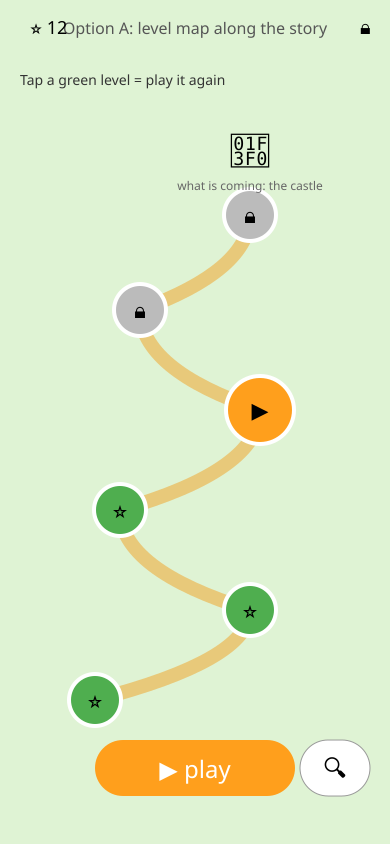
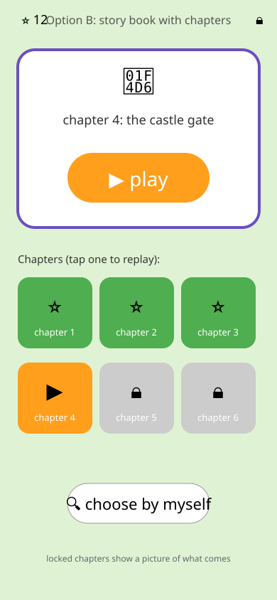

# #677 Home as a story level map (design first, no build)

Goal: one big **play** that follows the story, **replay** of what he played, a **free choice** one tap away, and a reason to follow the story (new levels that show what is coming). Phone mockups below (390x844); the owner picks one before any build.

## Option A: level map (recommended)

- **Play**: the one big button; it starts the glowing current level.
- **Replay**: tap any green (played) level.
- **Choose**: the 🔍 button stays one tap away (today's "something else").
- **Reason to follow**: a winding path to a castle; locked levels are grey and the goal at the top shows what is coming. A level opens when the day's missions are done.

## Option B: story book

- **Play**: the one big button inside the book card for the current chapter.
- **Replay**: tap a played chapter in the grid.
- **Choose**: "choose by myself" button under the grid.
- **Reason to follow**: locked chapters show a picture of what comes; more text on screen than A.

## Shared rules after the pick
Old saves: levels come from the existing daily path / story progress (no reset). Kid text Hebrew with nikud, added to pregen. Phone + desktop screenshots, `tests/run.sh` green.
