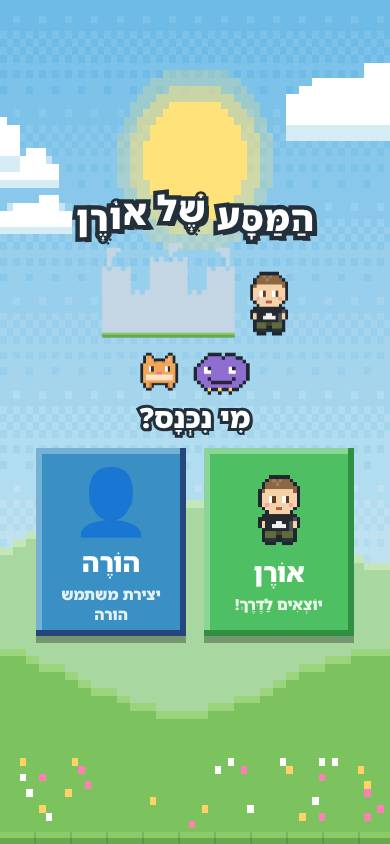
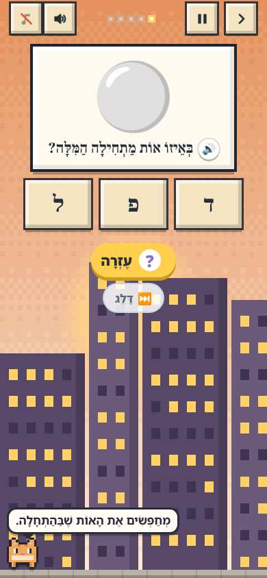
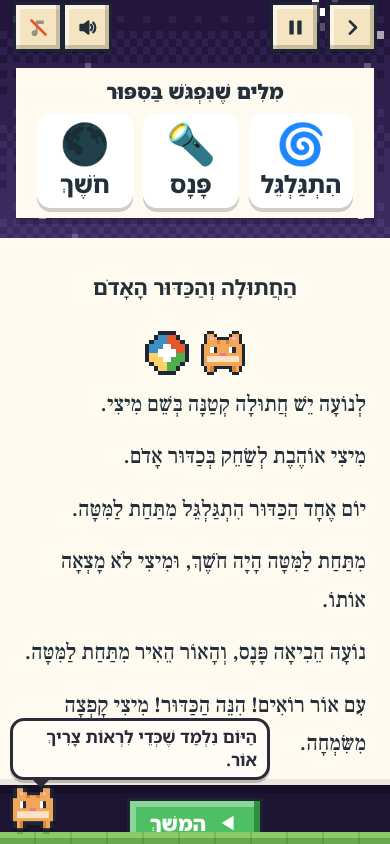
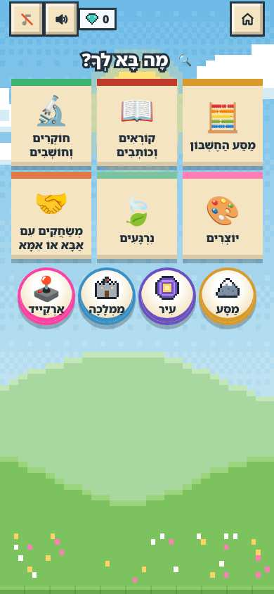

# דוח רעיונות לשיפור המשחק של אורן (#673)

תאריך: 28 בנובמבר 2026 · רק רעיונות. **קוד המשחק לא שונה.** כל הדמויות והאמנות המוצעות מקוריות (בלי דמויות או מותגים קיימים).
איך בוחרים: **עונים במספרים**, למשל «5, 9, 14» (או «הטופ 5»). כל רעיון מסומן במאמץ: 🟢 קטן · 🟡 בינוני · 🔴 גדול.

## מה יש היום (תמונות מהמשחק)
| מסך כניסה | שאלת קריאה | סיפור | «משהו אחר» |
|---|---|---|---|
|  |  |  |  |

מהתמונות ומהמסמכים (`STATUS.md`, `ux-audit-656.md`) רואים נכון: המשחק עשיר מאוד בתוכן (120 פעילויות, 12 בניינים, סיפור יומי, חבר בפינה), אבל **רוב מה שאורן מקבל הוא «שאלה ← יפה! ← שאלה»**. ארבעה כיוונים ליותר כיף: דברים שהוא **בונה ומחזיק**, חבר שהוא **מכיר ויזכור אותו**, **תחושת משחק** (תנועה, צליל, הפתעה), ו**סקרנות** (לגלות, לא רק לענות). הכול בלי לעמם את המסך — מסך אחד, פעולה ראשית אחת.

## א. עוד דברים מעניינים לאורן

**1. 🟢 «מה מסתתר?» — תמונה שנחשפת.** כל תשובה נכונה מסירה עוד חתיכה מציור (חיה, ספינה) עד שרואים אותו שלם. אורן מקבל סקרנות בכל שאלה.
```
[▓▓▓▓]   [▓▒░▒]   [ 🦊 ]
 0/3       2/3      !
```
**2. 🟡 הגן שלי.** כל משימה שהושלמה היא זרע/צמח/חיה קטנה שנוספת לגן אחד קבוע. שום מטבעות — רק מקום שגדל. מראים אותו בבית.
**3. 🟢 חידת היום.** חידה אחת קצרה בבוקר (מוקראת), בלי ניקוד; התשובה מתגלה בערב. מתאים לילד «חכם מאוד».
**4. 🟡 מכונת ההמצאות.** אורן מחבר 2–3 חלקים (צורה + צליל + צבע) ויוצא יצור/כלי מצחיק שמדבר. יצירה חופשית.
**5. 🟡 מסע במפה אמיתית.** כל שבוע «טיול» למקום אחר בעולם (מדבר, יער, קוטב) עם 3 עובדות מוקראות ומשחקון אחד.
**6. 🟢 «בואו נחפש בבית».** משימה אמיתית מהבית: «מצא 3 דברים עגולים». מחוברת למשימות העולם האמיתי הקיימות.
**7. 🔴 סטודיו קטן לציור ולמוזיקה.** קנבס פשוט ופסנתר קצר שנשמרים בגלריה. (יש כבר מוזיקה/בנייה — ללמוד מהם).

## ב. חבר טוב יותר

**8. 🟢 החבר זוכר.** «אתמול למדת את האות ש׳!» בפתיחת היום. שורה אחת, מנתוני השמירה שכבר קיימים.
**9. 🟡 החבר שואל «מה נעשה?».** פעם ביום הוא מציע שתי אפשרויות (במקום מסך רשימה): «קריאה או חיות?».
**10. 🟢 החבר מתעייף ושמח.** מצב רוח לפי היום: ישנוני בבוקר, מקפץ אחרי סיום משימות. תנועה בלבד, בלי טקסט נוסף.
**11. 🟡 אורן מלמד את החבר.** פעם ביום החבר «לא יודע» ואורן מסביר לו (בוחר מילה נכונה). הוראה לאחר היא הדרך הכי טובה ללמוד.
**12. 🟢 שם ותלבושת לחבר.** אורן נותן שם לחבר ובוחר כובע אחד. קשר אישי בזול.
**13. 🟡 חבר שמרגיש תסכול.** אחרי 2 טעויות החבר אומר «גם לי זה קשה, ננסה ביחד» (במקום עוד «אני כאן»). מתחבר לסולם העזרה הקיים.

## ג. תחושת משחק (game feel)

**14. 🟢 תשובה נכונה = «פופ» אמיתי.** קונפטי קטן, רטט קל, צליל שעולה בכל תשובה ברצף (דו-רה-מי…). רק תוספת לתגובה הקיימת.
**15. 🟢 כפתורים שמגיבים.** כפתור שנלחץ «שוקע» ומקפץ; ענן קטן כשנוגעים בצורה. עוזר גם ב־#656 (כפתורים גדולים יותר).
**16. 🟡 מעברים בין מסכים.** החלקה קצרה/«דלת נפתחת» במקום חתך חד. מרגיש כמו משחק ולא כמו טופס.
**17. 🟢 ספירה לאחור קצרה לפני קטעים מהירים** («3-2-1!») — בארקייד בלבד.
**18. 🟡 «ניצחון קטן» בסוף כל משימה.** 2 שניות של חגיגה (החבר רוקד + ציור שנחשף) לפני חזרה לבית. מחליף מסכים ארוכים.
**19. 🟢 צלילי רקע לפי עולם.** ציפורים ביער, גלים בים — קצרים ושקטים, עם כפתור הצליל הקיים.

## ד. מה עושים משחקי ילדים טובים (רעיונות בלבד)

- **פתיחה מיידית:** משחק טוב מתחיל לשחק תוך 3 שניות — בלי תפריטים. → רעיון 20.
- **«עוד אחד!»:** סיבוב קצר מאוד שמזמין חזרה, אך אצלנו תמיד עם סוף ברור (בלי אינסוף, כבר יש הפסקות).
- **אוסף בלי תחרות:** אוספים ומסדרים (מדבקות, חיות), בלי לוח מובילים.
- **חוקים שמתגלים לאט:** ממחישים במקום להסביר; כל משחק מציג חוק חדש אחד.
- **הצלחה בטוחה:** טעות לא «נענשת»; רמזים מגיעים לפני ייאוש.

**20. 🟢 «המשך מאיפה שעצרת».** כפתור אחד גדול בבית שחוזר בדיוק לפעילות האחרונה (יש כבר כפתור «ממשיכים» בעולמות — להרחיב לבית).
**21. 🟡 אוסף מדבקות חיות.** בסוף יום מקבלים מדבקה אחת מקורית; אלבום פתוח לצפייה. מחליף יהלומים.
**22. 🟡 «שבוע המסע».** מטרה שבועית אחת («מצא 5 חיות») עם שביל קטן, בלי לחץ ובלי עונשים.
**23. 🟢 סימן «חדש!»** נקודה קטנה על בניין/פעילות שאורן עוד לא ניסה. סקרנות ללא פירוט.

## טופ 5 — ההמלצה שלי

| # | רעיון | למה | מאמץ |
|---|---|---|---|
| **8** | החבר זוכר | הכי הרבה «חבר» בהכי פחות קוד; שורה אחת מנתונים קיימים | 🟢 |
| **14** | «פופ» בתשובה נכונה | משפר את כל 120 הפעילויות בבת אחת | 🟢 |
| **1** | «מה מסתתר?» | סקרנות בכל שאלה; מתאים לתמונות שכבר יש | 🟢 |
| **2** | הגן שלי | משהו שאורן בונה ורוצה לחזור אליו, בלי תחרות | 🟡 |
| **18** | ניצחון קטן בסוף משימה | סוף משימה מרגש במקום «הבא» | 🟡 |

אם בוחרים רק אחד: **8** (החבר זוכר).

## הערות
- שום רעיון לא מוסיף כפתור חדש למסך הראשי של אורן; רובם מוסיפים תנועה, צליל או שורה קצרה (חוק «פשטות קודם»).
- כל טקסט לילד יוכתב בעברית עם ניקוד מלא ויעבור הגייה (`voicecheck`) אם ייבנה.
- אם תבחרו, אפתח **כרטיס נפרד לכל רעיון** שנבחר (עם רשימת קבלה), אחרי בדיקה שאין כפילות בבקלוג.

**איך עונים:** כתבו מספרים («8, 14, 1») או «טופ 5» בשאלה שבלוח הבעלים.
